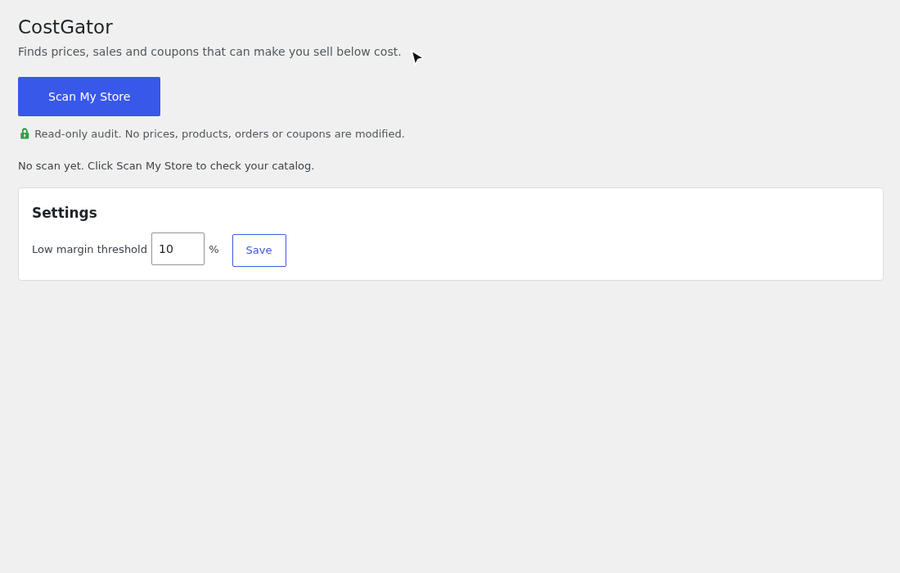

# CostGator Margin Audit for WooCommerce

Find WooCommerce products, sales and coupons that sell below cost or below your margin. Test a discount before you launch it.

This is the development repository of the free [CostGator Margin Audit for WooCommerce](https://wordpress.org/plugins/costgator/) plugin.



## What it does

* Lists products selling below cost, scheduled sales that would push a price below cost, and low margin products.
* Finds percentage coupons that would leave eligible products below cost or below your margin threshold.
* Shows products with missing cost information.
* Promotion Preflight: enter a discount and see which products would drop below cost before you launch it.

The audit is read-only. It never changes prices, products, orders or coupons, and the plugin makes no external requests.

Unit costs are read from the WooCommerce native Cost of Goods Sold feature, or from the Cost of Goods plugins by SkyVerge and WPFactory.

## Install

Install it from Plugins > Add New in your WordPress admin by searching for CostGator, or download it from the [plugin directory](https://wordpress.org/plugins/costgator/).

Requirements: WordPress 6.5+, PHP 7.4+, WooCommerce 8.0+.

## Support and bugs

* Questions and help: the [support forum on wordpress.org](https://wordpress.org/support/plugin/costgator/).
* Reproducible bugs: [GitHub Issues](https://github.com/Feriman22/costgator/issues). Please include your WordPress, WooCommerce and PHP versions and the cost plugin you use.

## Development

The repository contains a Docker based test site and the test suite. You need Docker with Compose, Python 3, curl, zip and unzip.

```sh
cp .env.example .env    # set the passwords
set -a; . ./.env; set +a
docker compose up -d --wait
W="docker compose run --rm -T cli wp"
$W core install --url="http://$WP_BIND:8088" --title=Test --admin_user=admin --admin_password="$WP_ADMIN_PASSWORD" --admin_email=admin@example.com --skip-email
$W plugin install woocommerce plugin-check --activate
$W plugin activate costgator
bash dev/run-tests.sh   # unit tests, seeded store checks, Plugin Check, HTTP smoke and XSS tests
bash dev/build-zip.sh   # builds dist/costgator-<version>.zip
```

`dev/compat/run.sh` is an optional release check on WordPress 6.5 to 6.8 with PHP 7.4 and WooCommerce 8.0.

The plugin itself is the `costgator/` folder. Everything else is tooling and is not shipped.

## License

GPL-2.0-or-later. See [LICENSE](LICENSE).

WooCommerce is a registered trademark of Automattic Inc. This plugin is not affiliated with or endorsed by Automattic or WooCommerce.
